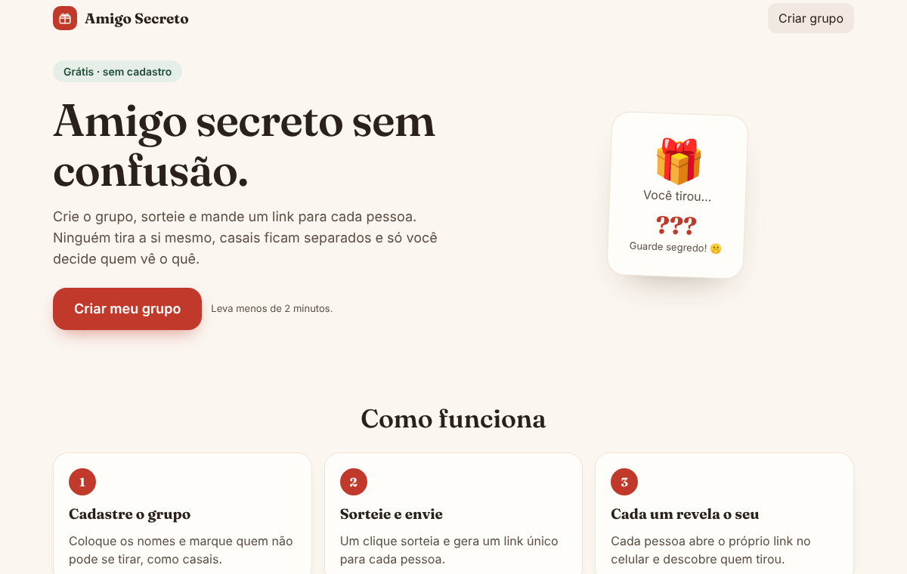
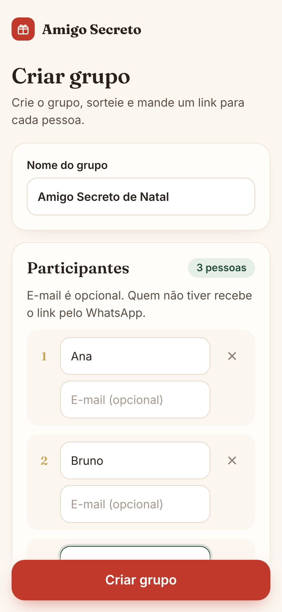

<div align="center">

# 🎁 Amigo Secreto

**Sorteio de amigo secreto sem confusão.**
Crie o grupo, sorteie e mande um link único para cada pessoa.

[](LICENSE)


[](CONTRIBUTING.md)



</div>

---

## Sumário

- [Por que existe](#por-que-existe)
- [O que faz](#o-que-faz)
- [Telas](#telas)
- [Como funciona o sorteio](#como-funciona-o-sorteio)
- [Rodar localmente](#rodar-localmente)
- [Configuração](#configuração)
- [Deploy no Railway](#deploy-no-railway)
- [Estrutura do projeto](#estrutura-do-projeto)
- [API](#api)
- [Privacidade e segurança](#privacidade-e-segurança)
- [Limitações conhecidas](#limitações-conhecidas)
- [Roadmap](#roadmap)
- [Contribuindo](#contribuindo)
- [Licença](#licença)

## Por que existe

Todo fim de ano alguém vira o organizador de um amigo secreto: junta os nomes, sorteia no papelzinho, descobre que um casal se tirou, refaz tudo e ainda manda mensagem para cada um. Este projeto resolve isso em poucos minutos, sem cadastro e sem ninguém ver o resultado dos outros.

## O que faz

- **Sorteio sem erros:** ninguém tira a si mesmo e cada pessoa recebe exatamente um amigo.
- **Pares proibidos:** casais e familiares não se tiram, nos dois sentidos.
- **Sorteio impossível:** o sistema detecta e diz qual participante está travando o sorteio.
- **Link de visualização única:** cada link fica preso ao primeiro aparelho que abrir. Em outro aparelho aparece o aviso "já foi aberto".
- **Link novo:** invalida o link antigo de um participante. **Refazer sorteio** gera links novos para todos.
- **Acompanhamento:** contador "X de N já viram" no painel do organizador, atualizado a cada 10 segundos.
- **Envio:** botão de WhatsApp com a mensagem pronta e botão de copiar o link.
- **Organizador opcional:** você escolhe se o organizador pode ver o resultado ou não.

## Telas

| Landing | Criar grupo (celular) |
|---|---|
|  |  |

## Como funciona o sorteio

1. O organizador cadastra os participantes e os pares proibidos.
2. A API embaralha os participantes até achar uma combinação válida (ninguém tira a si mesmo e nenhum par proibido se cruza). Se não achar, faz uma busca exaustiva (backtracking) para encontrar uma solução ou provar que não existe. Nesse caso, ela aponta os participantes mais restritos.
   O sorteio exige no mínimo 3 participantes.
3. Cada participante recebe um **token de visualização** aleatório.
4. Ao abrir o link, o aparelho envia um identificador próprio (`deviceId`). O primeiro aparelho a abrir fica vinculado ao link.

## Rodar localmente

**Pré-requisitos:** [.NET 10 SDK](https://dotnet.microsoft.com/download/dotnet/10.0) e [Node 22](https://nodejs.org).

```bash
git clone https://github.com/luizfernandothomaz/sorteio-amigo-secreto.git
cd sorteio-amigo-secreto
```

**Modo desenvolvimento** (dois terminais, com hot reload no front):

```bash
# terminal 1: API na porta 5080
cd api
PORT=5080 dotnet run
```

```bash
# terminal 2: front em http://localhost:5173
cd web
npm install
npm run dev
```

**Modo produção** (um único processo, como no Railway):

```bash
cd web && npm install && npm run build   # gera api/wwwroot
cd ../api && PORT=5080 dotnet run        # http://localhost:5080
```

> **Dicas**
> - No macOS, a porta 5000 é usada pelo Receptor AirPlay e responde `403` a tudo. Por isso o projeto usa a **5080**.
> - Se você só tem um runtime .NET mais novo que o 10, rode com `DOTNET_ROLL_FORWARD=Major`.
> - Mudou a porta ou o proxy em `web/vite.config.ts`? Reinicie o Vite, ele só lê a configuração ao iniciar.

## Configuração

| Variável | Obrigatória | Para que serve | Exemplo |
|---|---|---|---|
| `PORT` | não | Porta da API | `5080` |
| `PUBLIC_BASE_URL` | recomendada em produção | Base dos links enviados. Se ausente, usa o host da requisição | `https://amigo-secreto.up.railway.app` |


## Deploy no Railway

O repositório já traz o `Dockerfile` e o `railway.json` (build por Dockerfile e verificação de saúde em `/api/config`).

1. No Railway: **New Project → Deploy from GitHub repo** e escolha este repositório. Se ele for privado, autorize o app do Railway no GitHub.
2. Em **Settings → Source**, confirme a branch que será publicada (normalmente a `main`).
3. **Adicione um Volume** montado em `/data`. Sem ele, os grupos somem a cada deploy.
4. Em **Settings → Networking**, clique em **Generate Domain**.
5. Em **Variables**, defina `PUBLIC_BASE_URL` com o domínio gerado, por exemplo `https://amigo-secreto.up.railway.app`.
6. Faça o deploy e abra o domínio. A landing deve carregar, e criar um grupo deve funcionar.

O Railway define a variável `PORT` sozinho, e o `Dockerfile` já aponta o banco para `/data/db.json`. Para atualizar, basta dar push na branch publicada.

## Estrutura do projeto

```
.
├── api/                   # API .NET 10 (minimal API)
│   ├── Program.cs         # rotas e regras
│   ├── DrawService.cs     # algoritmo do sorteio
│   ├── JsonStore.cs       # armazenamento em arquivo (POC)
│   └── Models.cs
├── web/                   # front React + Vite + TypeScript
│   └── src/
│       ├── pages/         # Landing, CreateGroup, Panel, Reveal
│       ├── components.tsx
│       └── styles.css
├── docs/screenshots/
├── Dockerfile             # build do front + API
├── railway.json           # configuração do deploy no Railway
└── CONTRIBUTING.md
```

## API

| Método | Rota | Uso |
|---|---|---|
| POST | `/api/groups` | Cria o grupo e devolve `id` e `adminKey` |
| GET | `/api/groups/{id}?key=` | Painel do organizador |
| PUT | `/api/groups/{id}?key=` | Edita o grupo (apaga o sorteio) |
| POST | `/api/groups/{id}/draw?key=` | Sorteia ou refaz o sorteio |
| POST | `/api/groups/{id}/participants/{pid}/resend?key=` | Gera link novo para um participante |
| POST | `/api/reveal/{token}` | Participante revela o resultado (`{ deviceId }`) |

## Privacidade e segurança

- Não há login. A chave do organizador (`adminKey`) vai no link do painel: **quem tiver o link controla o grupo**. Guarde-o.
- O resultado do sorteio só é devolvido ao dono do link de cada participante (e ao organizador, se a opção estiver ligada).
- Se você usar analytics, não registre os caminhos `/r/*` e `/g/*`: eles carregam segredos na URL.
- Achou uma falha de segurança? Não abra uma issue pública. Veja [CONTRIBUTING.md](CONTRIBUTING.md#segurança).

## Limitações conhecidas

São da POC, não do produto final:

- Armazenamento em arquivo JSON. O plano é migrar para PostgreSQL (EF Core + Npgsql).
- Sem login nem tela para editar o grupo depois de criado (a API já tem `PUT /api/groups/{id}`).
- O vínculo do link usa o `localStorage`: aba anônima ou navegador limpo contam como "outro aparelho". A saída é o botão "Link novo".
- Não há testes automatizados.

## Roadmap

- [ ] Migrar de JSON para PostgreSQL
- [ ] Testes automatizados do sorteio e da API
- [ ] Tela para editar o grupo
- [ ] Lista de desejos por participante
- [ ] Valor sugerido e data da troca de presentes
- [ ] Contador de eventos no backend (grupos criados, sorteios, links abertos)
- [ ] Internacionalização (EN/ES)

Tem uma ideia? [Abra uma issue](../../issues/new/choose).

## Contribuindo

**Pull requests são bem-vindos!** 🎉 Tanto correções pequenas quanto funcionalidades novas.

1. Leia o [CONTRIBUTING.md](CONTRIBUTING.md).
2. Faça um fork e crie uma branch a partir da `main`.
3. Faça sua alteração e rode o build do front e da API.
4. Abra o pull request preenchendo o modelo.

Para mudanças grandes, abra uma issue antes para alinharmos a ideia.

## Licença

Distribuído sob a licença [MIT](LICENSE). Use, modifique e compartilhe à vontade.
